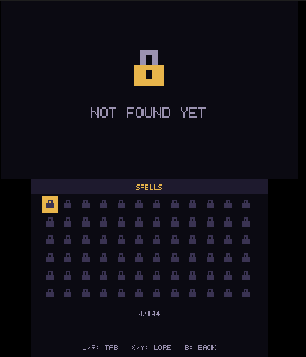

# Abyssal Eclipse 3DS

| Main Menu | Campaigns | Catalog |
|:---:|:---:|:---:|
|  |  |  |

**Survive the abyss. Master the elements. Break the cycle.**

**Status: v0.1 RELEASE.** Abyssal Eclipse is a 2D pixel-art arena-survivor roguelite built natively for Nintendo 3DS. It is written in C++17 with devkitARM, libctru, citro3d, and citro2d, and targets original (“Old”) 3DS hardware.

Sprites, bitmap text, sound effects, and music are generated procedurally; the game does not require external runtime art files. A 256×256 RGBA8 texture atlas is built in RAM at startup.

## Game and current features

You control a lone knight in a looping nightmare. Weapons attack automatically; move, dodge, collect experience, and build a spell loadout. Every spell now has a meaningful upgrade at each rank through level 5: upgrades improve its values, timing, radius, damage, duration, proc chance, or discrete effect counts as appropriate to that spell.

The beta currently includes:

- **144 spells** across six elements and five seasons, with five-level upgrades and balance adjustments.
- **25 enemy types**, including seasonal enemies, bosses, and distinct attack patterns.
- **Five seasons:** Forest, Desert, Snow, Mountain, and Eclipse.
- **All-Seasons Map:** clear all three Eclipse levels to unlock the scrolling 800×600 arena, where enemies from all five seasons spawn.
- **Fourteen achievements:** complete each season, reach lifetime kill milestones, complete a season catalog, and complete the full catalog.
- **Achievement rewards:** ordinary hats, faces, colors, and the Dwarf Beard are available immediately. Only five special parody outfits are achievement-gated: Batman, Joker, Terraria, Mario, and Iron Man.
- **Play-time achievements:** Little Dummy unlocks at 1 hour, Abyss Veteran at 10 hours, and Go Touch Grass at 50 hours, alongside dedicated achievement rewards for the five special outfits.
- **Lifetime statistics:** games, wins, losses, enemies killed, spells acquired and activated, spell upgrades, weapon throws, and play time are shown on the achievements screen.
- **Catalog and meta-progression:** campaign unlocks, discovered spells/enemies, achievement-gated clothes, and completed-season music tracks are shown in four catalog tabs. Unlocked season tracks can be previewed from the Music tab.
- **Active play-time counter:** lifetime time counts only active wave gameplay, not menus, allocation, spell selection, or paused time.
- **Stat-point bank:** unused level-up points can be stored for later during a run, with a hard limit of three store actions per session.
- **Balance update:** all XP gains receive a global +5% release tuning bonus before Luck modifiers.
- **Circle-art rasterization fix:** procedural SVG fragments are rasterized in paint order with real circle/ellipse geometry and inherited group strokes, rather than turning circles into rectangular bounds.
- **English and Brazilian Portuguese localization.**
- **Hardware-conscious runtime:** fixed gameplay pools, no gameplay heap allocation, compact procedural atlas, and an optional 30 FPS mode.

The save loader migrates legacy v1, v2, and v3 files to the current format. Newly added counters start at zero; existing unlocks and catalog progress are retained.

## Controls

- **D-Pad / Circle Pad:** Move during a run; navigate menus.
- **A:** Confirm / select. Attacks are automatic.
- **B:** Go back / pause-menu back action.
- **L / R:** Switch campaign seasons; cycle in-game tabs.
- **X / Y:** Select spell slots; scroll catalog lore. Y also starts the All-Seasons run after unlocking it.
- **START:** Pause.
- **SELECT:** Open the developer debug menu.
- **Touch screen:** Select menu items, campaign levels, and spell cards.

## Build and verification

Install devkitPro with the 3DS development packages and Python 3. Set `DEVKITPRO` and `DEVKITARM`, then build from the repository root:

```sh
python3 tools/gen_data.py   # regenerate after changing generator/data inputs
make
```

See [BUILD.md](BUILD.md) for the full `.3dsx` and optional `.cia` packaging instructions. The generated `.3dsx` is placed in the project root.

Run the host-side checks with:

```sh
sh verify.sh
```

This regenerates data, runs the native simulation/save/achievement/spell-level tests and procedural-art raster tests, and syntax-checks the 3DS backend. Host checks are not a substitute for compiling with devkitARM and testing on real hardware or an emulator; performance and the visual balance should still be reviewed on target.

## Credits

- **Game design and programming:** MrJuaumBR
- **AI assistants:** Claude, DeepSeek, Manus
