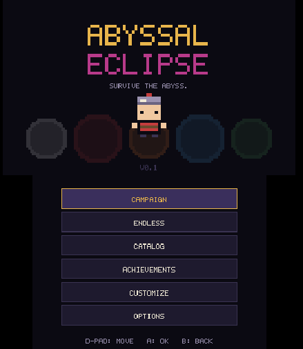
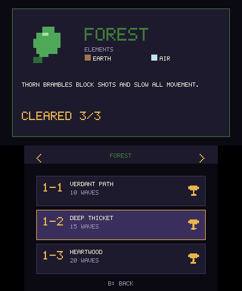
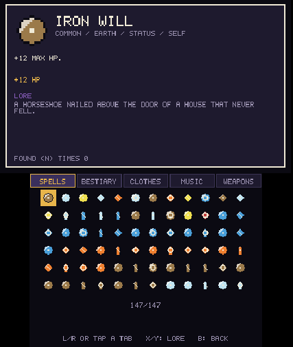
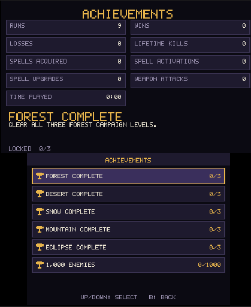
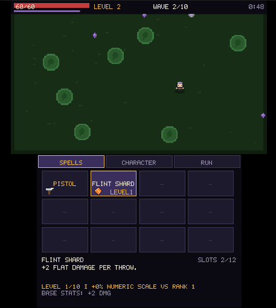

# Abyssal Eclipse 3DS

| Main Menu | Campaigns | Catalog | Achievements | In-Game |
| --- | --- | --- | --- | --- |
|  |  |  |  |  |

**Survive the abyss. Master the elements. Break the cycle.**

**Status: v0.2 BETA.** Abyssal Eclipse is a 2D pixel-art arena-survivor roguelite built natively for the original Nintendo 3DS. It is written in C++17 with devkitARM, libctru, citro3d, and citro2d.

Sprites, bitmap text, sound effects, and music are generated procedurally; the game does not require external runtime art files. A 256×256 RGBA8 texture atlas is built in RAM at startup.

## Game and current features

You control a lone knight in a looping nightmare. Weapons attack automatically; move, dodge, collect experience, spend stat points, and build a spell loadout through timed waves and boss fights.

<br>
<small>QR Code for FBI Installer</small>

### Spell ranks and caps

Spell upgrades advance one rank at a time. Rank 5 is **not** the general cap: most spells can reach Rank 10. Where applicable, generic numeric effects gain 20% per rank above Rank 1; custom timing, trigger frequency, and discrete counts follow their spell-specific formulas. Capped spells stop appearing as upgrade choices.

These six orbiting or summoned-entity spells are intentionally capped at **Rank 5** to prevent runaway entity counts: **Flame Wheel, Ball Lightning, Knife Circle, Sentinel, Sentinel Drone, and Fairy Companion**. **Time-Stop** caps at Rank 9 because its interval, duration, and cooldown reach their tuned limits by then. Most other spells can reach Rank 10. Elementalist Cycle triggers periodic elemental attacks rather than adding a persistent summon, so it retains the higher cap.

The selected-spell detail panel shows its description, current rank/cap, applicable numeric scaling or a custom-effect label, and Rank-1 stat values. The spell catalog also lists each spell’s authored description, stats, effect payload, scope, and cap in [CATALOG.md](CATALOG.md).

### World, enemies, and progression

- **147 spells** across six elements and five seasons, including global, element-linked, and season-exclusive spells.

- **25 enemy types**, including seasonal enemies, bosses, and distinct attack patterns.

- **Five seasons:** Forest, Desert, Snow, Mountain, and Eclipse, with a unique name for each campaign level.

- **All-Seasons Map:** unlocks after clearing all 15 campaign levels across the five seasons; the scrolling 800×600 arena mixes enemies from every season.

- **Twenty-three achievements:** season completion, lifetime kill milestones, catalog discovery, spell-use challenges, play-time milestones, and cosmetic unlocks.

- **Lifetime statistics:** games, wins, losses, enemies killed, spells acquired and activated, spell upgrades, weapon attacks, and play time appear on the achievements screen.

- **Play-time achievements:** Little Dummy at 1 hour, Abyss Veteran at 10 hours, and Go Touch Grass at 50 hours; several special outfits have separate achievement rewards.

- **Achievement rewards:** ordinary hats, faces, colors, and the Dwarf Beard are available immediately. Five parody outfits and the Elementalist air-nomad outfit are achievement-gated.

- **Stat-point bank:** unused level-up points can be stored for later in a run, with a hard limit of three store actions per session.

- **Active play-time counter:** lifetime time counts only active wave gameplay—not menus, allocation, spell selection, or paused time.

### Weapons, spells, and presentation

- **Nine weapons:** Dagger, Bow, Throwing Axe, Mage Staff, Shotgun, Pistol, retrievable Trident, Katana, and Machine Gun. Machine Gun unlocks after clearing every campaign level in all five seasons. The Catalog’s Weapons page lists descriptions, damage, attack interval, range, and lock status.

- **Katana swing:** close-range arc cleave with a curved slash trail and a dedicated procedural swish cue; its range was reduced.

- **Aura effects:** pulsing rings; electrical fields arc lightning to nearby enemies; Vacuum has a white field and outward-moving particles.

- **Spell HUD:** trigger counters, cooldown progress bars, and compact spell names on bottom-screen slot cards. The selected spell’s expanded information appears in the detail panel.

- **Chronos rarity:** Time-Stop is a legendary global spell that triggers every 12 attacks, freezes enemies and hostile projectiles for 1.2 seconds, and then requires a 14-second cooldown. Its higher ranks improve the effect modestly while preserving its emergency-use role.

- **Resistance clarity:** each Resistance point-up states its exact effect: +6 HP and 2% less damage taken.

- **UI fitting:** prominent button, header, menu, Catalog, and achievement labels are measured against bitmap-font widths and reduced when needed to avoid overflow.

- **Catalog and meta-progression:** five labeled tabs show spells, bestiary, clothes, music, and Weapons. Music tracks can be previewed after unlocking their season.

- **Music:** five procedural season tracks, plus a separate internal menu pattern.

- **Balance update:** XP gains receive a global +5% release-tuning bonus before Luck modifiers.

- **Localization:** English and Brazilian Portuguese.

### Technical notes

- **Old 3DS-conscious runtime:** fixed gameplay pools, no gameplay heap allocation, compact procedural atlas, and optional 30 FPS mode.

- **Old 3DS refresh fix:** cosmetic atlas updates flush the staging texture cache before upload, preventing stale character regions on hardware.

- **Circle-art rasterization:** procedural SVG fragments are rasterized in paint order with circle/ellipse geometry and inherited group strokes.

- **Save compatibility:** the save loader migrates legacy v1, v2, v3, and v4 files to the current format. Newly added counters start at zero; existing unlocks and Catalog progress are retained.

For the complete spell-by-spell and item-by-item reference—including descriptions, localized text, effect payloads, rank caps, weapon stats, music/SFX, enemies, seasons, achievements, cosmetics, and player stats—see [**CATALOG.md**](CATALOG.md).

## Controls

- **D-Pad / Circle Pad:** Move during a run; navigate menus.

- **A:** Confirm/select. Attacks are automatic.

- **B:** Go back / pause-menu back action.

- **L / R:** Switch campaign seasons; cycle in-game tabs and Catalog categories.

- **X / Y:** Select spell slots; scroll Catalog lore. Y also starts an All-Seasons run after unlocking it.

- **START:** Pause.

- **SELECT:** Open the developer debug menu.

- **Touch screen:** Select menu items, campaign levels, spell cards, and visible Catalog tabs.

## Build and verification

Install devkitPro with the 3DS development packages and Python 3. Set `DEVKITPRO` and `DEVKITARM`, then build from the repository root. The Makefile detects `python3`, `python`, or the Windows `py -3` launcher; generated game data is rebuilt automatically when its inputs change.

```
make clean && make
make regen                       # optional: force regeneration of art/spell data
```

See [BUILD.md](BUILD.md) for `.3dsx` output and optional `.cia` packaging instructions.

Run the art regression checks (the Aseprite round-trip check additionally needs Pillow):

```
python3 tools/test_art_raster.py
python3 tools/test_aseprite_sync.py
```

Use `py -3` instead of `python3` in those commands if that is the Python 3 launcher available in your Windows/MSYS2 setup.

## Debug spell and summon testing

## Aseprite art editing

Install Pillow for the optional art tool, then run `make aseprite-export`. Edit the native-size PNGs in `tools/aseprite_work/` with Aseprite and save over the same PNG (or save a same-name `.aseprite` project). Run `make aseprite-import` to update `tools/data/art.json`, create a dated backup, and regenerate `source/data_gen.cpp`. Keep the canvas size unchanged and use only opaque or fully transparent pixels. If importing `.aseprite` projects, set `ASEPRITE` to the Aseprite CLI executable; PNG import does not need the CLI. See [the art-pipeline guide](docs/art-pipeline.md) for examples and details.

## Debug spell and summon testing

During a run, open the debug menu using the existing debug unlock. **SPELL PICKER** opens a paged list of every spell; use D-pad to move, L/R to change pages, A to grant or upgrade the highlighted spell, and B to return. At a full loadout, the picker replaces the last non-weapon slot so spells remain testable. **SPAWN TEST GOLEM** creates a full-size Rock Golem independently of the Mountain King timer, for sprite/combat checks.

The procedural 32x32 character atlas is drawn at half the old scale to preserve the original 16x16 in-game footprint. The no-hat option is transparent. Art JSON is regenerated automatically before the normal build; `make regen` forces regeneration.

## Known limitations

- A real devkitARM build and physical-console test have not been run in this host-only environment.

- The Katana slash, animated aura particles/lightning, and simplified 16×16 weapon icon still need visual review on an emulator or 3DS. Host tests cannot judge on-device readability or sound quality.

- Spell balance above Rank 5 has simulation regression coverage but still needs hands-on gameplay tuning.

- The gallery keeps the five image paths from the supplied README. Three referenced screenshots (`catalog.png`, `achievments.png`, and `in-game-katana.png`) were not included in the uploaded project archive, so add those files under `data/` for the links to render when the project is opened elsewhere.

## Credits

- **Game design and programming:** MrJuaumBR

- **AI assistants:** Claude, DeepSeek, Manus

- **Some Arts come from:** [disven](https://disven.itch.io/pixel-swords-assets-16x16), [scrython](https://scrython.itch.io/pixelart-guns)