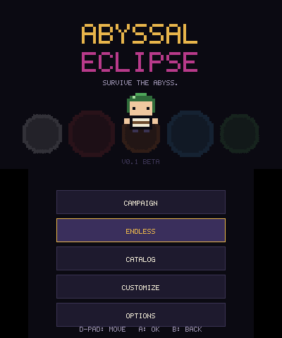
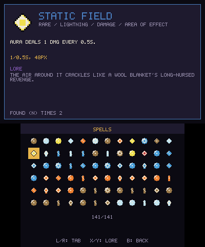

# Abyssal Eclipse 3DS

| Main Menu | Campaigns | Catalog |
|:---:|:---:|:---:|
|  |  |  |

**Survive the abyss. Master the elements. Break the cycle.**

Abyssal Eclipse is a fast-paced, 2D pixel-art arena-survivor roguelite built natively for the Nintendo 3DS. Written from scratch in C++17 using `devkitARM`, `libctru`, `citro3d`, and `citro2d`, the game is designed to run smoothly on the original "Old" 3DS hardware.

Everything you see—from the sprites and text to the music and sound effects—is generated procedurally at boot. No external asset files are required.

## About the Game

You are a lone knight trapped in a looping nightmare. Enemies swarm from all sides. You don't press a button to attack; your weapons fire automatically. Your only job is to move, dodge, and collect the souls of your fallen enemies to level up and acquire new spells. 

The game currently features **5 distinct seasons** (Forest, Desert, Snow, Mountain, and Eclipse), each with unique enemies, bosses, and elemental spell pools. 

**The Secret 6th Mode:** Clear all three levels of the Eclipse season to unlock the **All-Seasons Map**. This is an expansive 800x600 arena (scrolling camera included) where enemies from every season spawn simultaneously. Only the strongest builds survive.

## Features

- **137 Unique Spells:** Stackable, upgradeable, and categorized by elements (Water, Fire, Earth, Air, Blood, Lightning).
- **25 Enemy Types:** From swarming grubs to screen-filling bosses with unique AI patterns.
- **Procedural Everything:** A single 256x256 RGBA8 texture atlas is baked in RAM at startup. Zero external assets.
- **Dynamic Hazards:** Thorn brambles, frost patches, falling rocks, and solar flares change how you navigate the arena.
- **Full Localization:** Play in English or Portuguese (BR).
- **Meta-Progression:** A CRC-checked save system keeps track of your unlocked seasons, cataloged spells, and best endless waves.
- **Hardware Optimized:** Fixed memory pools, no gameplay heap allocation, and an optional 30 FPS battery-saving mode.

## Controls

- **D-Pad / Circle Pad:** Move in-game; navigate menus.
- **A:** Confirm / Select. *(Attacks are automatic!)*
- **B:** Go back / Pause menu back action.
- **L / R:** Switch campaign seasons; cycle in-game tabs.
- **X / Y:** Select spell slots; scroll lore in the catalog.
- **START:** Pause the game.
- **SELECT:** Open the developer debug menu.
- **Touch Screen:** Fully interactive menus, buttons, and spell cards.

## Credits

- **Game Design & Programming:** MrJuaumBR
- **AI Assistants:** Claude, DeepSeek, Manus

##  Building from Source

Ready to compile it yourself? Check out the **[BUILD.md](BUILD.md)** file for a step-by-step guide on compiling the `.3dsx` for the Homebrew Launcher, or packaging a `.cia` for the 3DS HOME Menu.