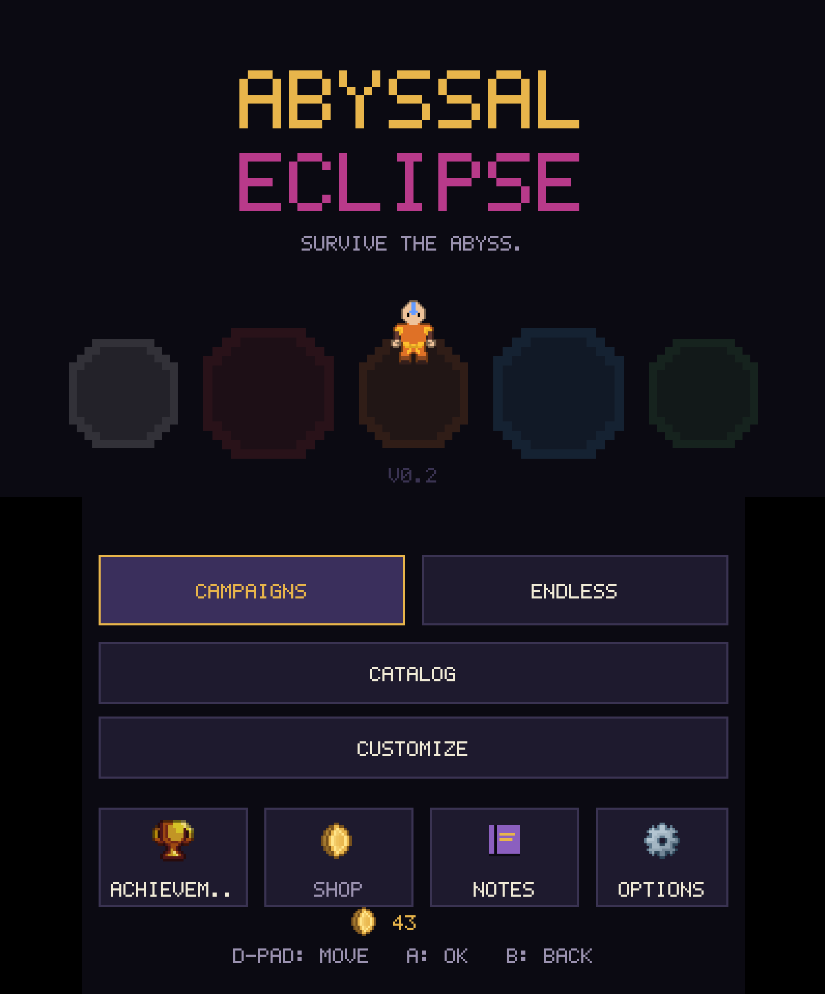
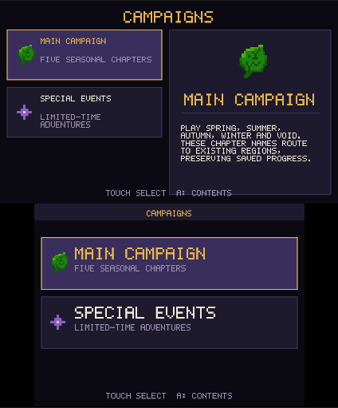
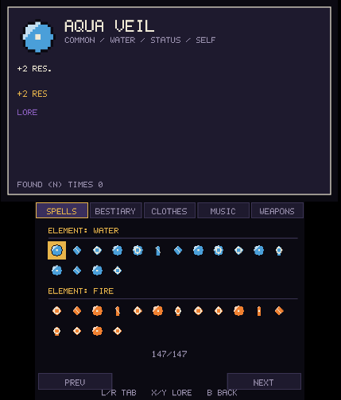
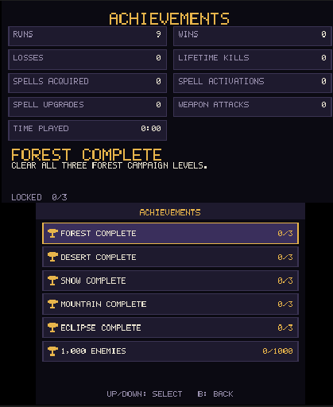
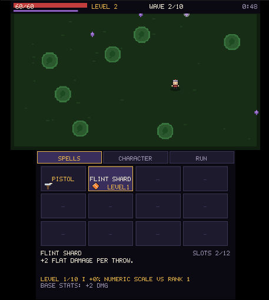

# Abyssal Eclipse 3DS

| Main Menu | Campaigns | Catalog | Achievements | In-Game |
| --- | --- | --- | --- | --- |
|  |  |  |  |  |

**Survive the abyss. Master the elements. Break the cycle.**

**Status: stable v0.2.** Abyssal Eclipse is a 2D pixel-art arena-survivor roguelite built natively for the original Nintendo 3DS. It is written in C++17 with devkitARM, libctru, citro3d, and citro2d.

Sprites, bitmap text, sound effects, and music are compiled or generated into the game; it does not require external runtime art files. Editable 16×16 pixel-art cells are packed into a 256×256 RGBA8 texture atlas built in RAM at startup.

## Game and current features

You control a lone knight in a looping nightmare. Weapons attack automatically; move, dodge, collect experience, spend stat points, and build a spell loadout through timed waves and boss fights.

<br>
<small>QR Code for FBI Installer</small>

### Spell ranks and caps

Spell upgrades advance one rank at a time. Rank 5 is **not** the general cap: most spells can reach Rank 10. Where applicable, generic numeric effects gain 20% per rank above Rank 1; custom timing, trigger frequency, and discrete counts follow their spell-specific formulas. Capped spells stop appearing as upgrade choices.

These six orbiting or summoned-entity spells are intentionally capped at **Rank 5** to prevent runaway entity counts: **Flame Wheel, Ball Lightning, Knife Circle, Sentinel, Sentinel Drone, and Fairy Companion**. **Time-Stop** caps at Rank 9 because its interval, duration, and cooldown reach their tuned limits by then. Most other spells can reach Rank 10. Elementalist Cycle triggers periodic elemental attacks rather than adding a persistent summon, so it retains the higher cap.

The selected-spell detail panel shows its description, current rank/cap, applicable numeric scaling or a custom-effect label, and Rank-1 stat values. The spell catalog also lists each spell’s authored description, stats, effect payload, scope, and cap in [CATALOG.md](CATALOG.md).

### World, enemies, and progression

- **147 spells** across six elements and five seasons, including global, element-linked, and season-exclusive spells.

- **25 enemy types**, including seasonal enemies, bosses, and distinct attack patterns.

- **Five seasons:** Forest, Desert, Snow, Mountain, and Eclipse, with a unique name for each campaign level.

- **Campaign hub:** a dual-screen campaign selector separates campaign groups from runtime season/save IDs. Main Campaign is the authored five-chapter order: Forest, Desert, Snow, Mountain and Eclipse. Special Events lists Christmas, Easter, and Halloween as upcoming content. New campaigns and contents can be added as data entries without replacing current progress.

- **Campaign touch selection:** bottom-screen taps only move the highlight; A opens the selected campaign or content. Touch coordinates are no longer compared with top-screen card rectangles, avoiding stale/wrong campaign selection.

- **All-Seasons Map:** unlocks after clearing all 15 campaign levels across the five seasons; the scrolling 800×600 arena mixes enemies from every season.

- **Nineteen achievements:** season completion, lifetime kill milestones, catalog discovery, spell-use challenges, play-time milestones, The Start (Endless wave 30), and cosmetic rewards grouped into their matching requirement achievement.

- **Achievement notifications:** newly earned achievements are queued and shown as popups over gameplay and menu screens.

- **Lifetime statistics:** games, wins, losses, enemies killed, spells acquired and activated, spell upgrades, weapon attacks, and play time appear on the achievements screen.

- **Play-time achievements:** Little Dummy at 1 hour, Abyss Veteran at 10 hours, and Go Touch Grass at 50 hours; several special outfits have separate achievement rewards.

- **Achievement rewards:** ordinary hats, faces, colors, and the Dwarf Beard are available immediately. Five parody outfits and the Elementalist air-nomad outfit are achievement-gated.

- **Stat-point bank:** unused level-up points can be stored for later in a run, with a hard limit of three store actions per session.

- **Active play-time counter:** lifetime time counts only active wave gameplay—not menus, allocation, spell selection, or paused time.

### Weapons, spells, and presentation

- **Ten weapons:** Dagger, Bow, Throwing Axe, Mage Staff, Shotgun, Pistol, retrievable Trident, Katana, Machine Gun, and Infinity Glove. Machine Gun unlocks after clearing every campaign level in all five seasons; Infinity Glove unlocks through its achievement. The Catalog’s Weapons page lists descriptions, damage, attack interval, range, and lock status.

- **Katana swing:** close-range arc cleave with a curved slash trail and a dedicated procedural swish cue; its range was reduced.

- **Aura effects:** pulsing rings; electrical fields arc lightning to nearby enemies; Vacuum has a white field and outward-moving particles.

- **Spell HUD:** attack and kill-trigger counters, cooldown progress bars, and compact spell names on bottom-screen slot cards. Kill effects have independent per-spell progress/cooldowns. The selected spell’s expanded information appears in the detail panel.

- **Endless spell sacrifice:** hold A or touch the selected spell's sacrifice button continuously for three seconds to remove a non-weapon spell at Rank 5 or higher. The fill bar shows hold progress; XP is `10 × rank + 2 × (player level − 1)`. Only one spell can be sacrificed each wave; the allowance refreshes when the next wave starts.

- **Coins and potions:** enemies can drop coins and healing potions. Potion odds rise by 0.05 percentage points per Luck point, plus 1 percentage point per Luck point for critical kills. Completing a season awards 100 coins once; the saved balance is shown on the main menu and run coins are shown in the HUD.

- **Run information:** the in-game Partida tab is now one continuous list with Run, Character, Combat, and Other sections. Touch-drag scrolls the list and X/Y fast-scroll without taking D-pad movement away from gameplay. Rows align current values and signed changes; positive changes are lime green, negative changes red-pink, and neutral changes light gray.

- **Character readability:** the Personagem tab aligns each current attribute with its signed difference from the base value while retaining the short effect description.

- **Chronos rarity:** Time-Stop is a legendary global spell that triggers every 12 attacks, freezes enemies and hostile projectiles for 1.2 seconds, and then requires a 14-second cooldown. Its higher ranks improve the effect modestly while preserving its emergency-use role.

- **Resistance clarity:** each Resistance point-up states its exact effect: +6 HP and 2% less damage taken.

- **UI fitting:** prominent button, header, menu, Catalog, and achievement labels are measured against bitmap-font widths and reduced when needed to avoid overflow.

- **Catalog and meta-progression:** five labeled tabs show spells, bestiary, clothes, music, and Weapons. Music tracks can be previewed after unlocking their season.

- **Catalog navigation:** Previous/Next visits sections in visual order, including wraparound; General Spells are no longer duplicated in elemental groups, so the final Eclipse section is reachable.

- **Music:** five procedural season tracks, plus a separate internal menu pattern.

- **Balance update:** XP gains receive a global +5% release-tuning bonus before Luck modifiers.

- **Localization:** English and Brazilian Portuguese.

- **Handmade art preservation:** the uploaded user-authored art JSON, generated sprite atlas output, and `art_concept/` references are preserved. No AI-generated sprite replacements were added.

### Update 0.2 follow-up fixes

- The main-menu achievement/options shortcut buttons now center their icons and fit their labels to the button width.
- Separate smartwatch-style debug menus are available on all non-gameplay screens and in-game. The private developer shortcut toggles them; the non-gameplay tools affect progression, while in-game tools target the active run. The shortcut is intentionally not shown in the game UI.
- Endless includes editable rules: random spell offers (on by default, or off to pick a starter and page through the full spell pool), lives (1 by default; choose 2, 3, or 5), and Easy/Normal/Hard enemy difficulty. Season checkboxes remain available; A toggles, Y selects all/clears all, and START begins through the checked released seasons.
- The reward-weapon Catalog now includes the Infinity Glove; it advances its projectile element only after each successful shot. Special-event campaign entries have unique Christmas, Easter and Halloween icons, included as 16×16 editable event art in ICO Aseprite export.
- Fairy, Sentinel, Drone, Potion, and Coin sprites are editable through the `SPELL` group in `aseprite_sync.py`. Stormbreak/other nth-impact spells now wait for a real enemy hit before resolving, and Tremble leaves a season-colored ground crack.
- A save-file v6 coin balance migrates v5 progress with zero starting coins; season-reward claim state is separate so obsolete padding cannot suppress a reward.
- The Credits screen mirrors the README Credits list. Lightning and bleed spells now have distinctive electrical and splash cues.
- Screen shake can be disabled in Options; it is limited to battlefield rendering and does not affect simulation.
- The requested Desert Pharaoh and Forest Brood lore is present in English and naturally translated Brazilian Portuguese.

- Abyssal Pact/Tidal Wave and other large-radius blast effects trigger screen shake; the accessibility toggle disables it.

## Technical notes

- **Old 3DS-conscious runtime:** fixed gameplay pools, no gameplay heap allocation, compact procedural atlas, and optional 30 FPS mode.

- **Old 3DS refresh fix:** cosmetic atlas updates flush the staging texture cache before upload, preventing stale character regions on hardware.

- **Circle-art rasterization:** procedural SVG fragments are rasterized in paint order with circle/ellipse geometry and inherited group strokes.

- **Save safety:** two alternating, generation-numbered, CRC-validated save slots retain the last good copy during writes. A third v6 `save.bin` recovery copy is kept, and invalid data is never silently replaced with defaults; the game warns and blocks writes when no valid copy can be recovered. Legacy v1–v5 files migrate without deleting their source.

- **Boot diagnostics:** `sdmc:/3ds/AbyssalEclipse/boot.log` is reset once per launch, then records timestamped startup stages, save-load status, language, economy/FPS mode, volumes, and display settings.

For the complete spell-by-spell and item-by-item reference—including descriptions, localized text, effect payloads, rank caps, weapon stats, music/SFX, enemies, seasons, achievements, cosmetics, and player stats—see [**CATALOG.md**](CATALOG.md).

## Controls

- **D-Pad / Circle Pad:** Move during a run; navigate menus.

- **A:** Confirm/select. Attacks are automatic.

- **B:** Go back / pause-menu back action.

- **L / R:** Switch seasons on the season/level picker; cycle in-game tabs/Catalog categories, Endless gamerule values, and manual spell-offer pages.

- **X / Y:** Select spell slots in Magias; scroll Catalog lore; fast-scroll the Partida stats list. Y also starts an All-Seasons run after unlocking it.

- **START:** Pause.

- **SELECT:** Open the developer debug menu.

- **Touch screen:** Select menu items, campaign/content highlights, levels, spell cards, and visible Catalog tabs; drag the Partida list to scroll. Hold the eligible spell’s sacrifice control for three seconds to exchange it for XP.

## Known limitations

- This follow-up was verified with the headless host suite and the project stub-based 3DS syntax check. A real devkitPro/devkitARM build and real 3DS hardware/emulator smoke test were not available here.
- Special-event Endless content remains a disabled placeholder until its seasons and gameplay data are authored.

## Build and verification

Install devkitPro with the 3DS development packages and Python 3. Set `DEVKITPRO` and `DEVKITARM`, then build from the repository root. The Makefile detects `python3`, `python`, or the Windows `py -3` launcher; generated game data is rebuilt automatically when its inputs change.

```
make clean && make
make regen                       # optional: force regeneration of art/spell data
```

See [BUILD.md](BUILD.md) for `.3dsx` output and optional `.cia` packaging instructions.

Run the art regression checks (the Aseprite round-trip check additionally needs Pillow):

```
python3 tools/test_art_raster.py
python3 tools/test_aseprite_sync.py
```

Use `py -3` instead of `python3` in those commands if that is the Python 3 launcher available in your Windows/MSYS2 setup.

## Aseprite art editing

Install Pillow for the optional art tool, then run `make aseprite-export`. Exports are merge-safe by default: rerunning the target preserves existing edited PNGs while adding new art files. Edit the native-size PNGs in `tools/aseprite_work/` with Aseprite and save over the same PNG (or save a same-name `.aseprite` project). This includes the 16×16 `SPELL` group (Fairy, Sentinel, Drone, Potion, Coin) as well as enemies, icons, hats, and faces. Run `make aseprite-import` to update `tools/data/art.json`, create a dated backup, and regenerate `source/data_gen.cpp`. Keep the canvas size unchanged and use only opaque or fully transparent pixels. If importing `.aseprite` projects, set `ASEPRITE` to the Aseprite CLI executable; PNG import does not need the CLI. To deliberately replace exported PNGs, run `make aseprite-export ASEPRITE_EXPORT_ARGS=--overwrite`. See [the art-pipeline guide](docs/art-pipeline.md) for examples and details.

## Credits

- **Game design, Some Arts and programming:** MrJuaumBR

- **AI assistants:** Claude, DeepSeek, Manus

- **Some Arts come from:** [disven](https://disven.itch.io/pixel-swords-assets-16x16), [scrython](https://scrython.itch.io/pixelart-guns)

- **AI Art Concepts:** [perchange.org](https://perchance.org/ai-pixel-art-generator)

## ROMFS Notes and Debug Atlas Export

`romfs/note.txt` is packed into the 3DS ROMFS and displayed in the scrollable Notes screen. Edit that file to publish a changelog or ideas, then rebuild the game. The main-menu developer overlay also has an **Export RAM Spritesheet** command; it writes `debug_spritesheet.pam` (RGBA; transparent pixels are preserved) to the game's writable storage folder. Pixel-art source entries may use SVG `fill-opacity` / `stroke-opacity`; the generator carries that alpha into the RGBA atlas.

For a heuristic source/sprite relationship diagram, run `python3 tools/map_connections.py` from the project root. It writes `sprite_code_connections.svg`.

## v0.2 AI-assisted project site

The repository now includes `index.html` for GitHub Pages. It loads the complete human-readable `CATALOG.md`, the ROMFS changelog, `AI_Changes.md`, and curated PNG previews from `previews/`. The page supports the MrJuaumBR ecosystem's dark/light and palette layers, responsive cards, keyboard focus, touch-sized controls, and reduced-motion preferences.

The main menu now exposes `[Achievements] [Shop] [Notes] [Options]` on the bottom screen. Shop currently displays the persisted coin balance and a safe inventory placeholder; no coins are spent until a future data-backed shop catalog and save contract are authored.

## Updated v0.2 follow-up

`index.html` now includes an ecosystem-style Appearance window, local Markdown rendering for the catalogue/changelog/AI log, and the supplied `data/` and `previews/` assets. The main-menu Shop entry is intentionally disabled as a coming-soon feature. Endless uses a future-proof season/level grid with multiple selections, disabled future cells, and a Game Rules popup for Random Spell and Lives. Campaign hub cards can be entered by touching the selected card directly or by pressing A.
